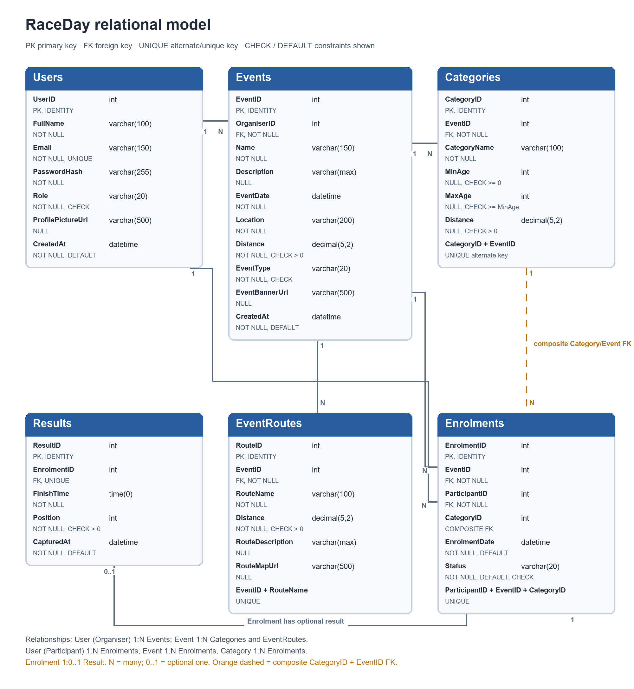

# RaceDay Event Management Platform

## 📖 Project Overview

The **RaceDay** platform is a comprehensive event management solution designed to bridge the gap between race Organisers and Participants. It allows Organisers to create and manage sporting events (Marathons, Cycling, Trail Runs) while enabling Participants to enrol, track categories, and view official race results.

## 📂 Repository Directory Structure

```text
RaceDay/
├── .github/
│   └── workflows/
│       └── build.yml
├── docs/
│   ├── Part1_ERD.png
│   ├── API_Endpoint_Plan.md
│   ├── RaceDay_Database.sql
│   └── Video_Presentation_Guide.md
├── schema.dbml
└── README.md
```

## 🗄️ SSMS Database Execution Guide

1. Open **SQL Server Management Studio (SSMS)** and connect to your instance.
2. Open the file located at `docs/RaceDay_Database.sql`.
3. Ensure you are connected to a target database (e.g., `RaceDayDB`).
4. Execute the entire script (F5). The script drops tables in reverse dependency order, creates all tables with strict constraints, and inserts realistic seed data automatically.

## 📊 Entity Relationship Diagram (ERD)

Below is the visual representation of our relational schema modeled in DBML.



*Note: Export this image by copying the `schema.dbml` file into [dbdiagram.io](https://dbdiagram.io).*

## 🔌 API Documentation

Review the full API routing plan, including HTTP methods, role-based access control (RBAC), request schemas, and failure handling in the [API Endpoint Plan](docs/API_Endpoint_Plan.md).

## 🎥 Video Presentation

Watch the architectural walkthrough and technical demonstration of Part 1:

👉 **[YouTube Video Presentation Placeholder]** *(Link to be updated post-recording)*
