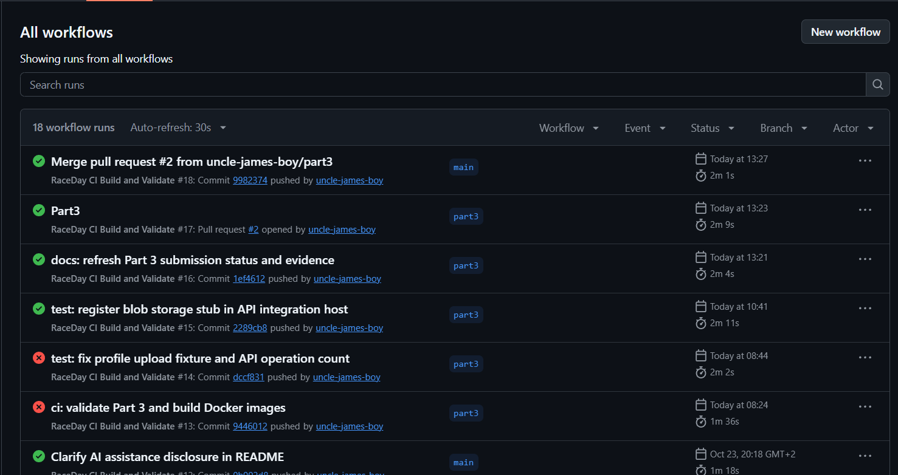
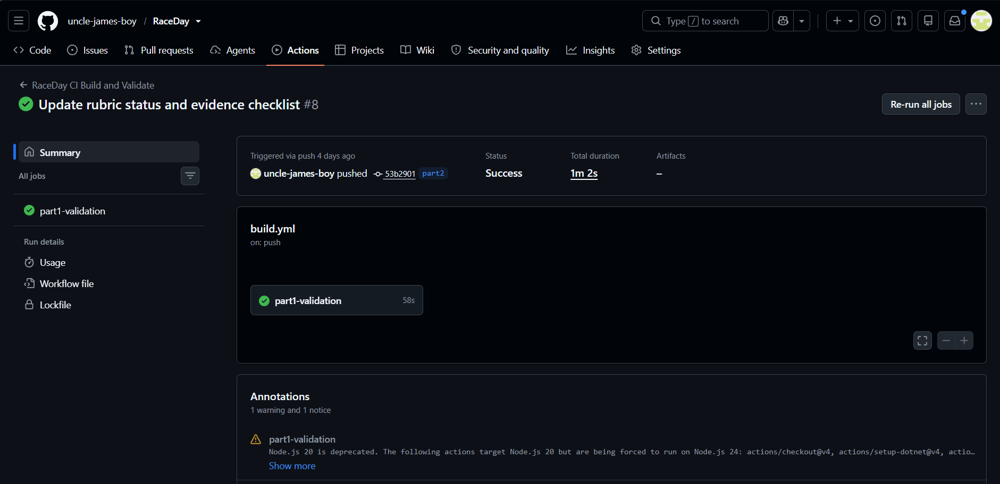
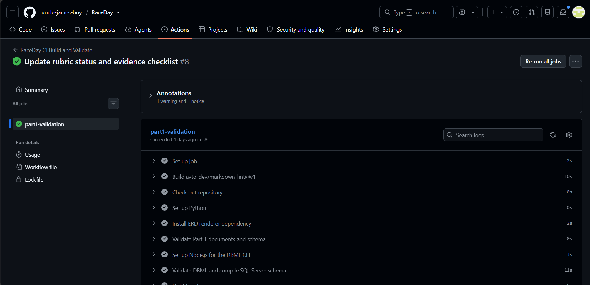

# RaceDay Event Management Platform

RaceDay is a road-race event management application for Organisers and Participants. It contains the six-entity Part 1 database design, a session-authenticated ASP.NET Core Web API, and an ASP.NET Core MVC application that consumes the API.

## Technology and requirements

- .NET 8, ASP.NET Core MVC and Web API, Entity Framework Core 8, and SQL Server
- Azure Blob Storage integration through the API; Azurite for local development
- Docker Desktop and Docker Compose for the local four-service deployment
- SQL Server LocalDB by default (or another SQL Server instance configured locally)
- PowerShell and the .NET 8 SDK

The API uses password hashing and server-side session authentication. A browser receives an HttpOnly session cookie; the server keeps the user ID and role in session state. This project does not use JWT. Organiser actions are role-checked and operations on owned events, categories, or routes check that the signed-in Organiser owns the event. Participants can access their own enrolments and results.

## Data model

| Entity | Purpose and key relationship |
| --- | --- |
| Users | Organiser and Participant accounts; Organisers own events and Participants make enrolments. |
| Events | Race events, each owned by a User. |
| Categories | An event's enrolment categories; each category belongs to one Event. |
| EventRoutes | Named course details belonging to an Event. |
| Enrolments | A Participant's entry in an Event and Category; stores both `EventID` and `CategoryID`. |
| Results | A race result associated with an Enrolment. |

Categories have an alternate composite key `(CategoryID, EventID)`. Enrolments reference that pair with the matching composite foreign key. This ensures the chosen category belongs to the same event as the enrolment.

The API currently exposes 28 operations across authentication, user profiles, events and banners, categories, routes, enrolments, and results. The MVC application provides role-specific participant and organiser pages and forwards each user's API session cookie through its typed API client. It does not access SQL Server or Blob Storage directly. See the [API endpoint plan](docs/API_Endpoint_Plan.md) for routes and access rules.

Event banners are public promotional images. Profile pictures are stored in a private Blob container; the API streams a user's own picture only after session authentication. Both upload flows validate JPEG, PNG, and WebP content. Event banners are limited to 5 MB; profile pictures are limited to 2 MB.

## Database setup

The default connection is `(localdb)\\MSSQLLocalDB`, database `RaceDayDB`. The API does not create or migrate the database on startup. Choose **one** setup method for a new, empty database:

1. **SQL script:** Open [`docs/RaceDay_Database.sql`](docs/RaceDay_Database.sql) in SSMS and run it only against a fresh disposable SQL Server instance/database. The script creates/selects `RaceDayDB`, creates the six tables, and inserts sample rows. It stops if RaceDay tables already exist; it does not drop or replace them. The sample password hashes are placeholders and cannot be used to log in.
2. **EF Core migration:** Install the EF tool once, then run the migration against a fresh database using the configured connection string:

   ```powershell
   dotnet tool install --global dotnet-ef --version 8.0.31
   dotnet ef database update --project src/RaceDay.Api/RaceDay.Api.csproj --startup-project src/RaceDay.Api/RaceDay.Api.csproj
   ```

   The migration creates the schema but does not insert sample records. Do not apply the migration to a database already created by the SQL script: the SQL script does not create EF migration history, so EF may try to create tables that already exist. Never run either setup method against data you need to preserve. To use a different SQL Server, set `ConnectionStrings__RaceDayDatabase` for the current shell or edit the local development settings; do not commit real credentials.

For the Docker Desktop setup, including the isolated SQL Server container, Azurite, one-time database setup, and persistent volumes, follow [the Docker guide](docs/DOCKER.md). The Docker database is separate from a Windows `.\SQLEXPRESS` database.

## Build, test, and run

Run these commands from the repository root:

```powershell
dotnet restore RaceDay.sln
dotnet build RaceDay.sln --no-restore --configuration Release
dotnet test tests/RaceDay.Api.Tests/RaceDay.Api.Tests.csproj --configuration Release
dotnet test tests/RaceDay.Web.Tests/RaceDay.Web.Tests.csproj --configuration Release
```

Run the API and MVC in separate terminals when starting them outside Docker:

```powershell
dotnet run --project src/RaceDay.Api/RaceDay.Api.csproj --launch-profile https
dotnet run --project src/RaceDay.Web/RaceDay.Web.csproj --launch-profile http
```

The API launch profile normally serves Swagger at `https://localhost:7107/swagger`; MVC uses `http://localhost:5157`. Database-backed API requests require a configured SQL Server database and appropriate data. The automated tests use EF Core InMemory and test HTTP clients; they do not prove a live SQL Server or Blob Storage connection. For Docker Desktop, follow [docs/DOCKER.md](docs/DOCKER.md) instead of using the local launch profiles.

## Project documents

- [Part 1 ERD](docs/Part1_ERD.png)
- [Part 1 DBML](schema.dbml)
- [Part 1 SQL Server script](docs/RaceDay_Database.sql)
- [API endpoint plan](docs/API_Endpoint_Plan.md)
- [Docker Desktop setup and run guide](docs/DOCKER.md)
- [Part 2 implementation blueprint](docs/Part2_Implementation_Blueprint.md)
- [Part 2 demonstration runbook](docs/PART2_DEMO_RUNBOOK.md)
- [Part 2 rubric checklist and evidence map](docs/Part2_Rubric_Checklist.md)
- [Part 1 presentation guide](docs/Video_Presentation_Guide.md)
- [Part 2 presentation guide](docs/Part2_Video_Presentation_Guide.md)

## Verification and evidence

Automated tests use EF Core InMemory and test HTTP clients; they do not prove a live SQL Server or Azurite connection. The checked-in CI screenshots below are from earlier Part 1/Part 2 runs and do not verify Part 3. The workflow includes `part3`, Docker Compose configuration validation, and API/Web image builds. GitHub Actions [Run #15](https://github.com/uncle-james-boy/RaceDay/actions/runs/44269215155) succeeded on commit `2289cb8`. A screenshot of that Part 3 run has not yet been saved in the repository. The `part3` branch contains 17 meaningful commits relative to `origin/main`; the rubric target is 20.

### Part 3 — GitHub Actions

The following screenshot shows the successful GitHub Actions workflow for the Part 3 implementation.



[View the successful Part 3 GitHub Actions run](https://github.com/uncle-james-boy/RaceDay/actions/runs/44269215155)

**GitHub Actions evidence for commit `53b2901`:** [Run #8](https://github.com/uncle-james-boy/RaceDay/actions/runs/39057052022)





The supplied [SSMS screenshot](docs/evidence/part1-sql-run.png.png) shows a successful query listing the six tables in `RaceDayDB`. It is supporting schema evidence; it does not show the SQL setup script being executed. The Part 1 video is the place to show the script running live. The evidence images are tracked in `docs/evidence/`; they are older Part 1/Part 2 evidence, not Part 3 CI screenshots.

## Demonstration videos

- [Part 1 — SQL and database demonstration](https://youtu.be/DtnpXK5yhq0?si=AsyMH0gIYYsvAGLj)
- [Part 2 — API and application demonstration](https://youtu.be/jX8b3rDCzcM?si=upj6Y6qbrTz7oh3E)

These links were supplied for this submission. The student reports that application browser checks are complete. Playback, audio quality, and unlisted-link access for the Part 1 and Part 2 videos still need to be checked in a private browser window.

The Part 3 rubric requires a video presentation. Its link is still outstanding; add it after recording and uploading the video. Do not use a placeholder link.

## Final submission

Use the [Part 3 rubric checklist](docs/Part3_Rubric_Checklist.md) to track the nine criteria and remaining evidence. The Part 3 Actions run succeeded, but its screenshot is not yet saved here. Record the Part 3 video link after uploading the recording, verify all video links in a private browser, reach the rubric's 20 meaningful Part 3 commits through genuine work, and submit the existing repository URL on ARC. Application browser checks have been completed according to the student; this README does not claim that the assignment is fully submitted or that all evidence is complete.

## AI assistance disclosure

AI assistance was used to review the assignment and help draft documentation. I reviewed and understood the submitted work and followed the assignment's academic integrity instructions.
