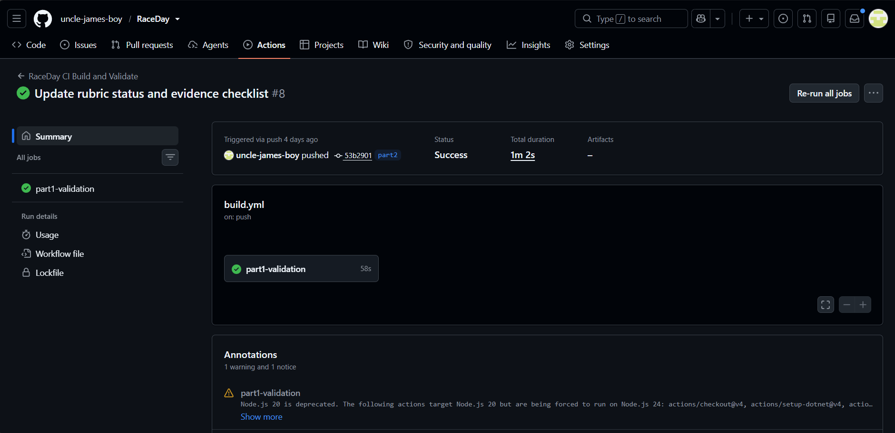
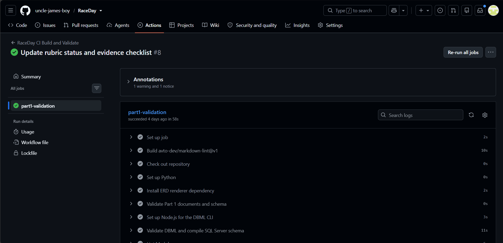

# RaceDay Event Management Platform

RaceDay is a road-race event management API for Organisers and Participants. The repository contains the six-entity Part 1 database design and the Part 2 ASP.NET Core Web API implementation.

## Technology and requirements

- .NET 8, ASP.NET Core Web API, Entity Framework Core 8, and SQL Server
- SQL Server LocalDB by default (or another SQL Server instance configured locally)
- PowerShell and the .NET 8 SDK

The API uses password hashing and server-side session authentication. A browser receives an HttpOnly session cookie; the server keeps the user ID and role in session state. This project does not use JWT. Organiser actions are role-checked and operations on owned events, categories, or routes check that the signed-in Organiser owns the event. Participants can access their own enrolments and results.

## Data model

| Entity | Purpose and key relationship |
| --- | --- |
| Users | Organiser and Participant accounts; Organisers own events and Participants make enrolments. |
| Events | Race events, each owned by a User. |
| Categories | An event's enrolment categories; each category belongs to one Event. |
| EventRoutes | Named course details belonging to an Event. |
| Enrolments | A Participant's entry in an Event and Category; stores both `EventID` and `CategoryID`. |
| Results | A race result associated with an Enrolment. |

Categories have an alternate composite key `(CategoryID, EventID)`. Enrolments reference that pair with the matching composite foreign key. This ensures the chosen category belongs to the same event as the enrolment.

The API plan documents 23 operations across authentication, profiles, events, categories, routes, enrolments, and results. Swagger exposes those operations and documents the session-cookie authentication scheme.

## Database setup

The default connection is `(localdb)\\MSSQLLocalDB`, database `RaceDayDB`. The API does not create or migrate the database on startup. Choose **one** setup method for a new, empty database:

1. **SQL script:** Open [`docs/RaceDay_Database.sql`](docs/RaceDay_Database.sql) in SSMS and run it only against a fresh disposable SQL Server instance/database. The script creates/selects `RaceDayDB`, creates the six tables, and inserts sample rows. It stops if RaceDay tables already exist; it does not drop or replace them. The sample password hashes are placeholders and cannot be used to log in.
2. **EF Core migration:** Install the EF tool once, then run the migration against a fresh database using the configured connection string:

   ```powershell
   dotnet tool install --global dotnet-ef --version 8.0.31
   dotnet ef database update --project src/RaceDay.Api/RaceDay.Api.csproj --startup-project src/RaceDay.Api/RaceDay.Api.csproj
   ```

   The migration creates the schema but does not insert sample records. Do not apply the migration to a database already created by the SQL script: the SQL script does not create EF migration history, so EF may try to create tables that already exist. Never run either setup method against data you need to preserve. To use a different SQL Server, set `ConnectionStrings__RaceDayDatabase` for the current shell or edit the local development settings; do not commit real credentials.

## Build, test, and run

Run these commands from the repository root:

```powershell
dotnet restore RaceDay.sln
dotnet build RaceDay.sln --no-restore --configuration Release
dotnet test RaceDay.sln --no-build --no-restore --configuration Release
dotnet run --project src/RaceDay.Api/RaceDay.Api.csproj --launch-profile https
```

Open the HTTPS URL printed by `dotnet run` and add `/swagger` if needed. The launch profile normally serves Swagger at `https://localhost:7107/swagger`. Database-backed API requests require a configured, migrated SQL Server database and appropriate data. Automated tests use EF Core InMemory and an in-process HTTP server; they exercise API/session behaviour but do not prove a live SQL Server connection.

## Project documents

- [Part 1 ERD](docs/Part1_ERD.png)
- [Part 1 DBML](schema.dbml)
- [Part 1 SQL Server script](docs/RaceDay_Database.sql)
- [API endpoint plan](docs/API_Endpoint_Plan.md)
- [Part 2 implementation blueprint](docs/Part2_Implementation_Blueprint.md)
- [Part 2 demonstration runbook](docs/PART2_DEMO_RUNBOOK.md)
- [Part 2 rubric checklist and evidence map](docs/Part2_Rubric_Checklist.md)
- [Part 1 presentation guide](docs/Video_Presentation_Guide.md)
- [Part 2 presentation guide](docs/Part2_Video_Presentation_Guide.md)

## Verification and evidence

The repository records a local Release build and **41 passing tests** from 14 October 2026; those results use the in-memory test database described above. A genuine GitHub Actions run succeeded on commit `53b2901` (`part2`), running Part 1 validation, DBML conversion, Markdown lint, restore, Release build, and tests. The screenshots below are the manually supplied captures of that run. Because this README and checklist are now being updated after that run, capture a new successful Actions run for the final pushed commit before treating CI evidence as final.

**GitHub Actions evidence for commit `53b2901`:** [Run #8](https://github.com/uncle-james-boy/RaceDay/actions/runs/39057052022)





The supplied [SSMS screenshot](docs/evidence/part1-sql-run.png.png) shows a successful query listing the six tables in `RaceDayDB`. It is supporting schema evidence; it does not show the SQL setup script being executed. The Part 1 video is the place to show the script running live. No live SQL connection was verified by the repository checks recorded here.

## Demonstration videos

- [Part 1 — SQL and database demonstration](https://youtu.be/DtnpXK5yhq0?si=AsyMH0gIYYsvAGLj)
- [Part 2 — API and application demonstration](https://youtu.be/jX8b3rDCzcM?si=upj6Y6qbrTz7oh3E)

These links were supplied for this submission. Playback, audio quality, and unlisted-link access still need to be checked by the student in a private browser window.

## Final submission

Review the [rubric checklist](docs/Part2_Rubric_Checklist.md), verify the final commit has a green GitHub Actions run and matching screenshots, check both video links in a private browser, and submit the existing repository URL on ARC. The local evidence images are untracked until added to Git; include the evidence files and any approved documentation edits in the final changes so they appear on GitHub.

## AI assistance disclosure

AI assistance was used to review the assignment and help draft documentation. I reviewed and understood the submitted work and followed the assignment's academic integrity instructions.
